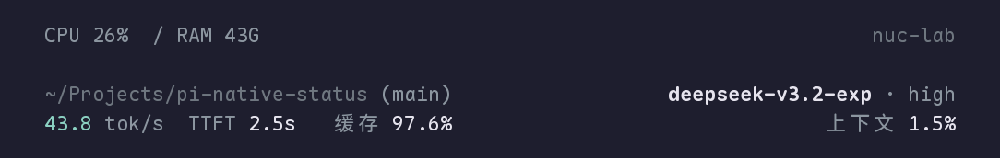
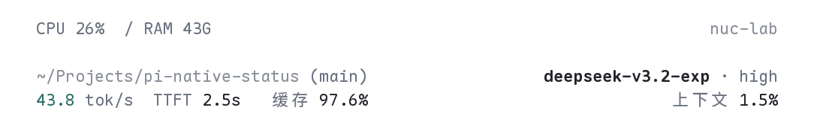

# Pi CLI 原生状态栏 · pi-native-status

为 Pi Coding Agent 打造的轻量终端状态栏：全屏模式下在固定顶部查看 CPU、内存与主机信息，底部用两行整齐呈现工作目录、Git 分支、模型、上下文占用，以及当前请求的首字延迟（TTFT）、生成速度（TPS）与缓存命中率。支持 macOS 和 Linux，适配深色与浅色主题。

A compact native status bar for Pi: host resources on one header line, and location, model, context, and measured request performance on two footer lines.

扩展在 Pi 全屏布局中为顶部资源栏单独预留一行，并使用原生 footer；不启动后台服务、不产生网络请求。另附可选的 Ghostty 字体切换工具，可切换 Maple Mono 等本机已安装字体。





> 预览使用演示数据，字体为 Maple Mono NF CN。实际数字来自运行 Pi 的本机与当前请求。

## 特点

- **固定顶部**：Pi 全屏模式下，资源栏始终位于屏幕第一行，聊天正文从下一行开始滚动。
- **轻量布局**：1 行 header（CPU / RAM / 主机名）+ 主体 2 行 footer（cwd / 分支 / 模型 / thinking / 性能指标）。其他扩展提供非空状态时，另加 1 行低权重状态，保留扩展间的兼容性。
- **模型只显示一次**：模型名加粗；实测 TPS 使用灰青色强调；辅助项使用 muted 颜色，不抢内容注意力。
- **请求指标**：生成速度（TPS，tokens/s）、首字延迟（TTFT）、缓存命中率与上下文占用集中在一行。最近一次已完成请求的性能保留至新请求开始。
- **深浅主题自适应**：跟随 Pi 当前主题与浅色/深色外观。
- **窄终端安全截断**：在 40 / 60 / 80 / 120 / 160 列宽度下都不会溢出，路径中间省略、分支与模型尾部省略。
- **次要信息按需查看**：累计 tokens、provider、完整 RAM、TTFT 与速度等通过 `/native-status details` 查看。
- **本地、只读**：使用系统资源计数与 provider usage；不记录或上传聊天内容，不读取凭据，也不自行打开会话文件；计时只检查输出片段是否非空，不保存片段文本。

## 安装

要求 Pi 1.5.0（已在 macOS 与 Linux 验证）、Node.js >= 22.19。运行时 SDK 由 Pi 提供，插件通过 `peerDependencies: "*"` 使用；没有运行时第三方依赖，也没有安装 hooks。

```bash
pi install git:github.com/Roundly/pi-native-status@v0.4.4
```

通过 Git 安装过旧版的用户，重新执行上面的安装命令即可更新到 `v0.4.4`，随后执行 `/reload`。手动复制安装的迁移方式见下方“避免重复加载”。

安装后在 Pi 中执行：

```text
/reload
```

然后确认状态栏出现：

```text
/native-status
```

### 全屏固定布局

Pi 1.5.0 默认使用全屏模式。此模式下，顶部资源栏固定在聊天滚动区之外，正文、输入区和底部状态栏各自保留原有空间。

若使用 `--tui-mode regular`，终端的原生历史滚动会移动整个屏幕，资源栏会作为普通 header 显示。需要固定顶部时，请在 `/settings` 中把 TUI mode 设为 `fullscreen`，或使用 `pi --tui-mode fullscreen` 启动。

固定布局适配会检查宿主结构；无法识别时保留兼容 header 并提示原因，可通过 `/native-status details` 查看状态。

### 开关与详情

```text
/native-status on        # 开启
/native-status off       # 关闭并恢复 Pi 默认 header/footer
/native-status details   # 查看累计 tokens、provider、完整资源与请求指标
```

也可以在启动 Pi 时使用 `--native-status-off` 禁用本次运行的状态栏。

### 卸载

使用与安装时相同的 source 卸载：

```bash
pi remove git:github.com/Roundly/pi-native-status@v0.4.4
```

### 避免重复加载

状态栏会替换 Pi 的 header/footer。如果已经手动加载过本扩展的副本，或正在使用其他 footer 扩展，请只保留一个来源，避免重复注册与重复绘制。迁移时，可先将手动副本移出 Pi 的扩展目录，或通过对应安装来源停用旧扩展。

## 指标含义

| 指标 | 含义 |
| --- | --- |
| CPU | 本机所有核心的差分利用率。启动后的首次采样没有差值，显示 `—`。 |
| RAM | `43/64G 67%` 表示已用 43 GiB、总量 64 GiB、占用率约 67%。已用量按总量减空闲量计算，包含系统缓存。 |
| TTFT | 从发起请求到收到第一个非空的 text / thinking / tool-call 片段。 |
| TPS | `provider usage.output` 除以“首个片段 → `message_end`”的客户端耗时。这是整段生成的平均值，不是流式实时 token 速率。 |
| 缓存 | 本次请求的 `cacheRead / (input + cacheRead + cacheWrite)`。 |
| 上下文 | 来自 Pi 的官方上下文用量 API；无法获得时显示 `—`，不做估算。 |

补充行为：

- 最近一次已完成请求的 TTFT / TPS / 缓存会保留至新请求开始，表示上次请求的观测结果；CPU / RAM 与上下文用量仍按当前状态显示。
- 新请求开始或请求失败时，会清除上一次的成功计时，避免把旧数字当作当前结果。
- 恢复历史会话时，缓存率从当前会话分支最近的有效请求恢复；不会恢复或伪造 TTFT / TPS，只有当前运行中真实发生的请求才会产生这些计时数字。
- 额度（5h / 7d 等）没有可靠数据源时不展示。
- TUI 启动时采样，之后约每秒采样一次，重绘节流为 200 ms；RPC、print、json 模式不启动 UI 或计时器。

## 字体（可选）

界面本身不捆绑字体。推荐搭配 [Maple Mono NF CN](https://github.com/subframe7536/maple-font)；字体采用 OFL，需从官方仓库自行安装，本仓库不附带字体二进制。

`tools/agent-font` 是一个独立的 Ghostty 字体切换工具，不会被 Pi 自动加载。用法、备份与回滚行为见 [docs/fonts.md](docs/fonts.md)。

## 开发与测试

```bash
npm ci
npm run typecheck
npm test            # 单元与渲染测试
npm run test:fonts  # 字体工具测试，需要 Python 3
npm run test:smoke  # 离线 PTY 冒烟测试，使用隔离的 mock provider，不产生费用
npm run test:scroll # 全屏多屏长对话滚动测试，需要下方 Python 测试依赖
npm run preview     # 生成终端预览
```

`test:smoke` 与 `test:scroll` 使用独立的临时 agent 目录和 mock provider，不读取用户的 Pi 配置，也不访问真实模型。滚动测试需要终端屏幕解析器，可先建立测试环境：

```bash
python3 -m venv .venv-test
. .venv-test/bin/activate
python -m pip install -r requirements-test.txt
npm run test:scroll
```

## 兼容性

- Pi 1.5.0：已在 macOS 与 Linux 验证。
- Node.js >= 22.19；日常开发测试使用 Node.js 24。
- CI 配置覆盖 Ubuntu / Node.js 22.19.0、Ubuntu / Node.js 24、macOS / Node.js 24，运行类型检查、单元测试、字体工具测试与离线 PTY 测试；滚动测试额外使用 `requirements-test.txt` 中的测试依赖。
- Python 3：仅用于可选的字体工具测试与离线 PTY 测试；滚动测试额外使用 `requirements-test.txt` 中的测试依赖。

## 许可证

MIT © Roundly

字体 Maple Mono NF CN 属于第三方资源，遵循其自身的 OFL 许可证，不包含在本仓库中。
